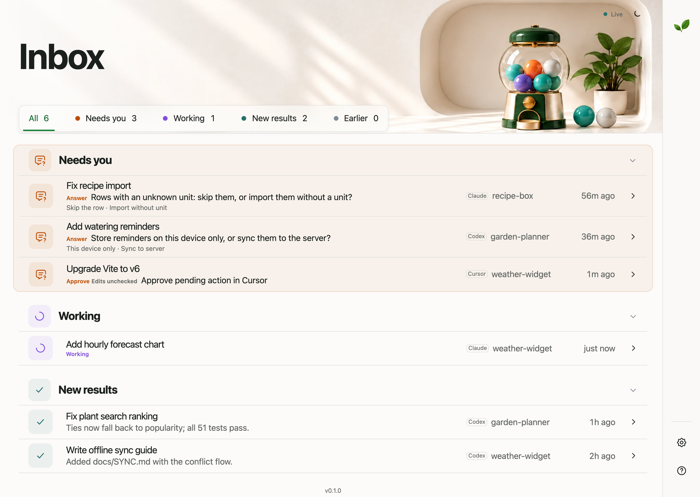
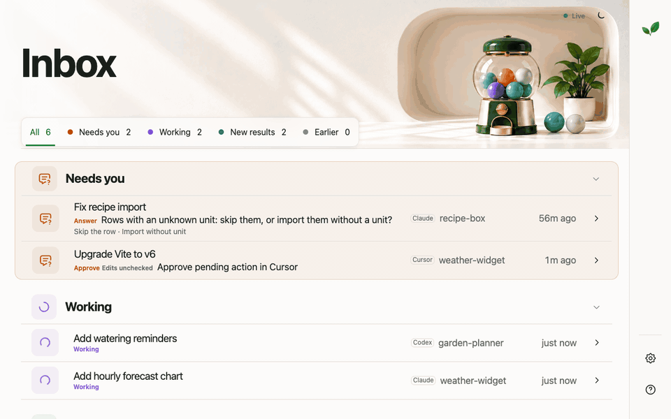

<div align="center">

# Your Turn

### Your agents are fast. You're the queue.

**An inbox that shows which Codex, Claude Code, or Cursor chat needs you, what it did, whether you
can trust it, and what to do next.**


[Start](#start) · [How it works](#how-it-works) · [Design](#design) ·
[Development](#development)



<sub>Made-up demo chats from <code>make screenshots</code>, not real session data.</sub>

</div>

Coding agents are capable enough now that the slow part is the person running them. Codex runs in
one terminal, Claude Code in another, Cursor in the IDE; each answer is long, and the one blocked on
you sits in a window you are not looking at. The usual fix is to click through every window and
skim every log. Your Turn reads the files those apps already write and turns them into one queue,
so you can see without switching:

- **Who is waiting on me?** A question, a pending approval, or a finished turn that asks you to act.
- **Can I trust the result without reading the whole log?** Whether checks ran after the last code
  edit, and whether they passed.
- **What is the next step?** One line, and a button that opens the chat in its own app.

It is not another agent runner, IDE wrapper, or cloud dashboard. It starts nothing, needs no
account or config, and works on the chats you already have. The four questions it answers per chat:

| Question | Where the answer is |
| --- | --- |
| Does it need me? | The status (Needs you, Working, or Done) and the Needs you count |
| What happened? | The recap and the files the chat changed |
| Can I trust it? | The checks it ran, with **Check failed** or **Edits unchecked** when they don't cover the latest edit |
| What do I do next? | The next step, with a button to act on it in the chat's own app |

- **Local only.** The server listens on `127.0.0.1`. Nothing leaves your machine.
- **Read-only.** It reads the session files each agent already writes and never changes them.
- **No new workflow.** It never starts, answers, or approves anything; you act in the agent's app.

When an agent asks a question, its chat moves into Needs you within a second:



## Start

You need Python 3.11+, [`uv`](https://docs.astral.sh/uv/), and at least one of Codex, Claude Code,
or Cursor.

```sh
uvx --from git+https://github.com/martin-gomola/your-turn your-turn install
uvx --from git+https://github.com/martin-gomola/your-turn your-turn serve
```

1. `install` sets up the handoff for each app it finds (`~/.codex`, `~/.claude`, `~/.cursor`) and
   exits. You need it once.
2. `serve` starts the inbox on [http://127.0.0.1:8787](http://127.0.0.1:8787) and runs until you
   press Ctrl+C.
3. Restart the apps. From then on, agents end each answer with an Outcome, a Next step, and a
   Recap, say which checks they ran, ask their questions with options, and note their decisions.
   That is what makes the recaps exact.

Everything goes into your own app folders, never into a project, so no repository gains a file or
a `.gitignore` entry:

| App | What `install` sets up |
| --- | --- |
| Codex | The `your-turn` plugin, which holds the handoff skill |
| Claude Code | `~/.claude/skills/your-turn/SKILL.md` and a marked `your-turn` block in `~/.claude/CLAUDE.md` |
| Cursor | `~/.cursor/skills/your-turn/SKILL.md` |

The handoff is plain text in the agent's answer, so nothing runs in the background and no app asks
for a permission. Running `install` again changes nothing, and it leaves the rest of `CLAUDE.md` as
it was. It also removes the `your-turn` MCP server that earlier versions registered.
`--harness codex`, `claude`, `cursor` or `all` picks the apps yourself. `your-turn uninstall` takes
the same options and removes exactly what `install` added.

Your existing chats from all three apps appear right away. Next time, run only `serve`.

<details>
<summary>Only the inbox, or install from a clone</summary>

| You want | Do this |
| --- | --- |
| Only the inbox, no handoff | Run only `serve`. Recaps fall back to the first paragraph of each answer and a guessed next step. |
| The handoff format without installing anything | Paste [docs/agents-snippet.md](./docs/agents-snippet.md) into the app's global instructions, such as `~/.codex/AGENTS.md`. |
| To develop Your Turn | Clone the repo and run `make install`. The plugin then runs from your checkout, and the server starts in the background. If the clone is not at `~/dev/your-turn`, set `YOUR_TURN_REPO` in the environment Codex runs in. |

</details>

It also works in the Codex in-app browser, beside the chat:


## How it works

Each app already writes its chats to disk. Your Turn follows those files as they change and turns
each chat into a short recap.

| App | What Your Turn reads | Change the location with |
| --- | --- | --- |
| Codex | Session files under `~/.codex/sessions`, and chat titles from `~/.codex/session_index.jsonl` | `--codex-home` or `CODEX_HOME` |
| Claude Code | Transcripts under `~/.claude/projects` | `--claude-home` or `CLAUDE_CONFIG_DIR` |
| Cursor | Agent transcripts under `~/.cursor/projects/*/agent-transcripts`, where Cursor writes them | `--cursor-home` |
| Cursor | Chat titles, folders, branches, last edits, archived and sub-agent flags, and pending approvals from `globalStorage/state.vscdb`, opened with SQLite `mode=ro` | `--cursor-user-dir` (default: `~/Library/Application Support/Cursor/User` on macOS, `~/.config/Cursor/User` on Linux, `AppData/Roaming/Cursor/User` on Windows) |

Newer Cursor versions write no transcript for top-level chats and keep their messages in the cloud.
Those chats come from their `state.vscdb` row alone: title, folder, branch, the files Cursor lists as
edited, pending approval, and last update.

`your-turn serve` and `your-turn install` take the same options: `--port` (default 8787) and the
four location flags above. The server always binds `127.0.0.1`.

The apps do not record the same things, so each chat shows only what its source can back up:

| | Codex | Claude Code | Cursor |
| --- | --- | --- | --- |
| Turn start and end | Logged by Codex | Inferred from prompts and the last text block | Logged in the transcript; without one, only the last update |
| Questions to you | Structured questions with options | `AskUserQuestion`, caught mid-turn while the agent waits | `AskQuestion`; the answer text is not recorded |
| Pending approvals | Not logged | Not logged; a quiet chat names the tool call still without a result | `hasBlockingPendingActions` from `state.vscdb` |
| Check results | Real exit codes | Pass or fail (tool error flag) | Not recorded |
| Timestamps | Per event | Per event | Per turn |
| Token usage | Yes | Yes | No |
| Handoff from `install` | Plugin with the skill | Skill and `CLAUDE.md` block | Skill |
| Chat action | **Open in Codex** | **Copy resume command** (`claude --resume <id>`) | **Open in Cursor** (project folder) |

| Part | What it does |
| --- | --- |
| Inbox | Groups chats into Needs you, Working, New results, and Earlier. Each count is also a filter. |
| Chat page | The outcome, next step, changed files, checks, decisions, and full timeline, with the chat's action button. |
| Alerts | The tab title and favicon show the Needs you count. Desktop notifications are optional. |
| App badge | Each row says whether the chat is from Codex, Claude, or Cursor. |
| Quiet tag | A working chat silent for two minutes. It may be waiting on an approval or a long command. For Claude Code, its tooltip names the call still waiting, such as `Bash: make deploy`. |
| Check tags | **Check failed** when the latest check failed. **Edits unchecked** when code changed with no test or lint after it. Edits to Markdown, text, and `docs/` alone raise neither. |
| Reminders | **Dismiss reminder** clears a chat from Needs you in this browser. It never answers anything in the agent's app. |

Recaps come from the agent's final answer:

| If the final answer has | Your Turn shows |
| --- | --- |
| `**Outcome:**`, `**Next step:**`, and `**Recap:**` lines | Those lines as written |
| `**Decision:** <question> -> <chosen> (over <alternatives>). <reason>` lines | One decision each, with its options; `→` works too |
| No handoff lines | The first paragraph as the outcome, and a best-guess next step: Run, Review, or Answer |

Decisions that older Codex, Claude Code, and Cursor chats logged through the `log_decision` tool
still show.

A chat lands in **Needs you** when it has an unanswered question, a pending Cursor approval, or a
finished turn whose next step is Answer, Review, Approve, Run, Decide, or Do. A check is a command
that runs a test, lint, type-check, or build tool (`pytest`, `ruff`, `tsc`, `npm test`,
`make check`, and similar); `rg pytest` is a search, not a check. A later run of the same check
replaces the earlier result.

What stays out, so the inbox lists only chats you opened and only what you typed:

- Sub-agents: Codex sub-agent threads and headless `codex exec` runs, Claude Code sidechain
  transcripts, and Cursor composers flagged as sub-agents. Starting one shows as a step in its
  parent chat.
- Archived Cursor chats, empty Cursor transcripts, transcripts Cursor no longer indexes in
  `state.vscdb` (deleted or cleaned-up chats), and Cursor rows with no title or update time (drafts),
  plus every chat with no activity within `history_days`.
- Abandoned Cursor turns: a turn with no end, no pending approval or question, and no transcript
  write for an hour is shown as stopped instead of Working.
- Context the apps inject into prompts: Codex environment blocks, Claude Code system reminders,
  hook output and slash-command wrappers, and Cursor's context tags.
- Unreadable data: malformed lines are skipped, a file that shrinks is re-read from the start, and
  an unreadable `state.vscdb` drops Cursor titles, approvals, and the archived and sub-agent
  filters, while the transcripts still load.

The in-app Help page covers statuses, privacy, and troubleshooting.

### Settings

Set the history window in `config.toml` at the repository root, then run `make restart`:

```toml
history_days = 14
```

The inbox shows chats whose session file changed in that many days. Direct chat links still open
older chats.

### Limits

| App | Limit | What you see |
| --- | --- | --- |
| All | Recaps come from the agent's final answer | Without handoff lines: the first paragraph and a guessed next step |
| Codex, Claude Code | Approval requests are not logged | Working, then Quiet. Quiet never counts as Needs you; a long command looks the same |
| Claude Code | The tool call waiting on approval is known | Quiet names it, such as `Bash: make deploy` |
| Claude Code | No exit codes, only error or not | Checks show pass or fail without the code |
| Claude Code | No chat deep link | **Copy resume command** |
| Cursor | Approvals are logged | Needs you with **Approve pending action in Cursor**; ignored after 24 hours without activity |
| Cursor | Transcripts record commands, not results | No pass or fail; timeline times per turn |
| Cursor | Chats without a transcript | Title, folder, branch and edited files only; Working only if updated in the last two minutes |
| Cursor | No global instructions file | The skill applies when the agent picks it, not in every chat |
| Cursor | No chat deep link | **Open in Cursor** opens the project folder |

## Design

Every feature has to shorten one of the four questions above; anything else stays out. The UI
borrows from Google Inbox's highlights, Material's large top app bar, Stephen Few's glanceable
dashboards, and Google PAIR's guidance on showing when to trust an AI. The full contract is in
[DESIGN.md](./DESIGN.md).

## Development

| Command | Use it when |
| --- | --- |
| `make install` | First setup, or to update the plugin |
| `make up` | Start the server in the background (`PORT=...` to change from 8787) |
| `make status` | Check whether it is running |
| `make logs` | Follow the server log |
| `make restart` | Pick up code or config changes |
| `make down` | Stop the server |
| `make test` | Run the test suite |
| `make screenshots` | Regenerate the README images from demo chats (needs Google Chrome and ffmpeg) |

| Route | Returns |
| --- | --- |
| `GET /api/inbox` | Recent chats with status, outcome, next step, and check state |
| `GET /api/threads/<key>` | Snapshot of one chat. `<key>` is `codex:<id>`, `claude:<id>`, or `cursor:<id>`; a bare id means Codex |
| `GET /api/stream?thread=<key>` | Server-sent events when that chat changes; without `thread`, inbox events |

```text
src/yourturn/                 FastAPI server, session engine, and installer
src/yourturn/harness/         One adapter per app: Codex, Claude Code, Cursor
src/yourturn/static/          Dashboard HTML, CSS tokens, and JavaScript
plugin/                       Codex plugin: manifest and the your-turn-handoff skill
tests/                        Parser and API tests
scripts/                      Demo-data screenshot and GIF generator for this README
docs/images/                  README images
```

Guides: [Design contract](./DESIGN.md) · [Handoff skill](./plugin/skills/your-turn-handoff/SKILL.md) ·
[Handoff format without the plugin](./docs/agents-snippet.md)

## License

[MIT](./LICENSE). Third-party icons and artwork notes are in [THIRD_PARTY_NOTICES.md](./THIRD_PARTY_NOTICES.md).
