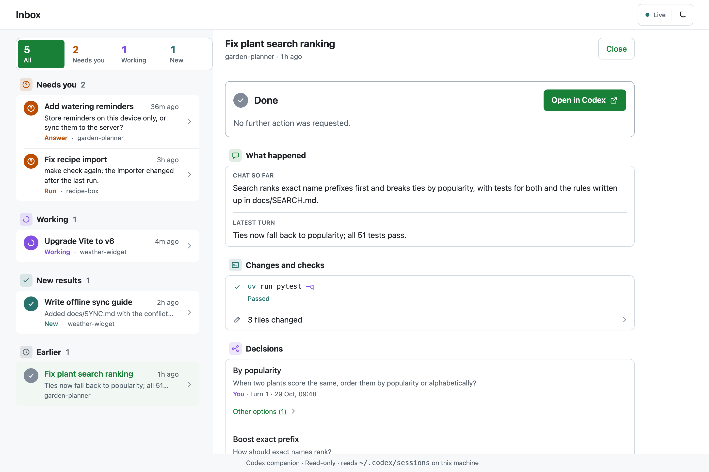
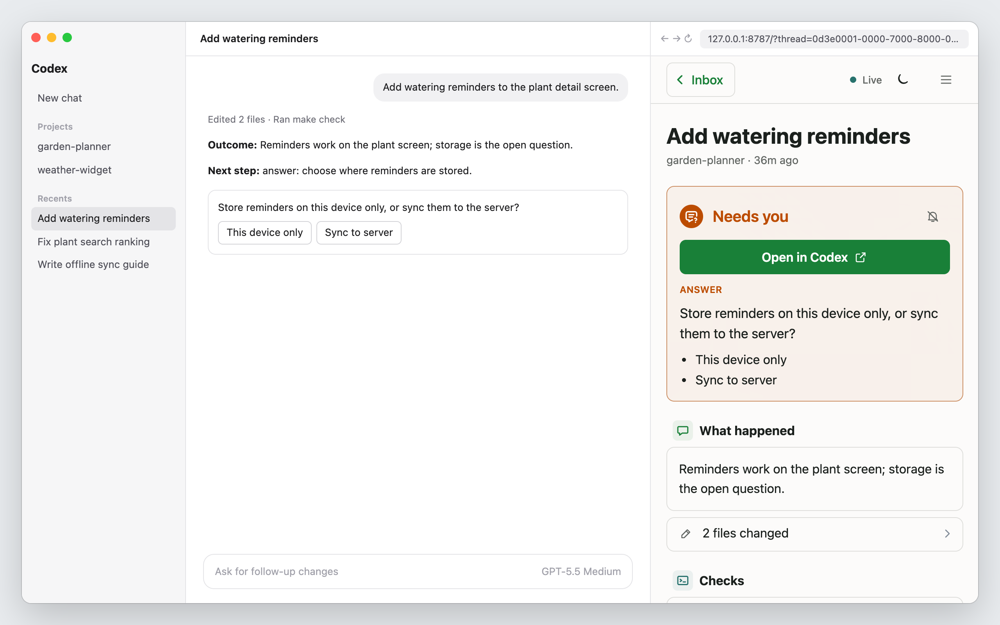

<div align="center">

# Your Turn

**An inbox for your coding agents. See which chat is waiting on you, what each one produced, and
what to do next.**


[Start Your Turn](#start-your-turn) · [Commands](#commands-you-will-use) ·
[How it works](#how-it-works) · [Guides](#guides)




<sub>Screenshots use made-up demo chats from <code>make screenshots</code>, not real session data.</sub>

</div>

Your Turn is a local, read-only inbox for your Codex chats, with an optional Codex plugin. It reads the
session files Codex already writes and turns each chat into a short recap: status, outcome, next
step, changed files, and checks.

Your Turn does not start, route, or control agents, and it has no config file. The chats you already
have appear as soon as it starts, and every action still happens in the Codex app.

## Why this exists

I run many Codex chats in parallel. Agent answers are long, so when I come back to a chat I lose the
outcome, the decision it is waiting for, or whether the tests ran after the last edit. Scrolling the
transcript to find that is slow, and with several chats open it is easy to miss the one that is
blocked on me.

Your Turn answers three questions per chat:

| Question | Where the answer is |
| --- | --- |
| Does it need me? | The status (Needs you, Working, or Done) and the Needs you count in the inbox |
| What happened? | The recap and outcome, the files the chat changed, and the checks it ran |
| What do I do next? | The next step, with **Open in Codex** to act on it |

The path from a busy afternoon of chats to the next action is:

**inbox → chat recap → Open in Codex → act**

## What you need

- Codex (desktop app or CLI), which writes chats to `~/.codex/sessions`
- Python 3.11+ and [`uv`](https://docs.astral.sh/uv/)

## Start Your Turn

```sh
git clone https://github.com/martin-gomola/your-turn.git ~/dev/your-turn
cd ~/dev/your-turn
make up
```

To try it without cloning, run
`uvx --from git+https://github.com/martin-gomola/your-turn your-turn serve`.

Open [http://127.0.0.1:8787](http://127.0.0.1:8787) for the inbox, or `/?thread=<thread_id>` for one
chat. It works in a normal browser and in the Codex in-app browser, where it sits beside the chat:



<sub>A mock Codex window with a made-up demo chat, rendered by <code>make screenshots</code>.</sub>

To get structured recaps, install the plugin and restart Codex:

```sh
make mcp
```

`make mcp` registers this repo as a local plugin marketplace (`.agents/plugins/marketplace.json`
points to `plugin/`) and installs `your-turn`. The plugin's MCP server runs from this checkout
through `uv`. If the repo lives somewhere other than `~/dev/your-turn`, set
`YOUR_TURN_REPO`.

If you would rather not install the plugin, paste the block from
[docs/agents-snippet.md](./docs/agents-snippet.md) into `~/.codex/AGENTS.md` or a repo's
`AGENTS.md`. Codex then writes the same Outcome, Next step, and Recap lines, but agent decisions are
not logged.

## Commands you will use

| Command | Use it when |
| --- | --- |
| `make up` | Start the server in the background (`PORT=...` to change from 8787) |
| `make status` | Check whether it is running |
| `make logs` | Follow the server log |
| `make restart` | Pick up server code changes |
| `make down` | Stop the server |
| `make mcp` | Install or update the Codex plugin |
| `make test` | Run the test suite |
| `make screenshots` | Regenerate the README screenshots from demo chats (needs Google Chrome) |

## How it works

Codex writes every chat to `~/.codex/sessions/YYYY/MM/DD/rollout-<timestamp>-<thread_id>.jsonl`.
Your Turn tails those files; it never writes to `~/.codex`.

- **Inbox.** A summary at the top counts all chats, chats that need you, chats still working, and
  unseen results from the last 24 hours; each count is also a filter. Below it, chats are listed in
  sections in that order, then Earlier. A section with more than five chats ends with **Show all**.
  It covers the 30 most recently updated chats, plus older chats from the last 14 days that still
  need you, and hides sub-agent chats. Filtered chat links keep their return scope. The page
  follows the system light or dark appearance; the sun/moon switch in the header overrides it in
  this browser.
- **Alerts.** The tab title shows the Needs you count and the favicon gets an orange badge. Turn on
  the bell in the header to get a system notification when a chat newly needs you, or has been
  quiet for five minutes, while the tab is in the background; clicking it opens the chat. It works
  from the inbox and from chat pages, as long as a Your Turn tab is open.
- **Quiet chats.** A working chat whose session file has not changed for two minutes is tagged
  **Quiet 4m** (with the time it has been quiet) and sorts first under Working. It is a hint: the
  chat may be waiting on an approval prompt, or running a long command.
- **Check tags.** Rows show **Check failed** when a check's latest run failed and **Edits
  unchecked** when the latest turn changed code with no test or lint after them. Documentation-only
  edits do not count.
- **Board.** From 1280px wide, for example on a separate monitor, the inbox becomes a read-only
  board with one column per status. Clicking a card opens the chat in a wide panel, and the board
  collapses into the inbox list beside it until the panel is closed.
- **Project labels.** The session's working directory is matched to project roots in Codex's local
  state database. When that is unavailable, the label is the working-directory name.
- **Chat page.** The latest turn's outcome and next step, the files it changed, the checks it ran
  (tests, lint, type checks, builds), a warning when files changed after the last check, decisions,
  earlier turns, and the full activity timeline. **Open in Codex** opens the chat in the Codex app
  through its `codex://threads/<id>` link.
- **Handoff format.** The outcome and next step come from the agent's final answer. The plugin's
  `your-turn-handoff` skill asks agents to start every final answer with `**Outcome:**` and
  `**Next step:**`, and from the second turn on to add a `**Recap:**` line that sums up the whole
  chat; the chat page shows the latest recap above the outcome, even while a new turn runs.
  Without those lines, Your Turn uses the answer's first prose paragraph and infers an Answer
  step when the reply opens with a request or ends with a question.
- **Decisions.** The questions Codex asked you, with your answers, plus choices the agent logs with
  the plugin's `log_decision` MCP tool.
- **Reminders.** **Dismiss reminder** removes a chat's request from the Needs you count in this
  browser, and **Restore reminder** brings it back. A new recorded request resurfaces on its own.
  Dismissals sync between tabs on the same origin and never answer a question or approve work in
  Codex. If browser storage fails, the reminder stays active; clearing site data clears dismissals.
- **Session info.** The Session details row shows the latest reported token totals and last-request
  usage from `token_count` records, and model and effort from `turn_context`. Session metadata
  supplies the provider, recorded Git branch, client version, and working directory. Cached input
  and reasoning are subsets of input and output, not extra totals. Missing counts stay unknown.
  Rate-limit snapshots in the logs are not used as a live account-quota meter.

## Privacy and limits

The server binds to `127.0.0.1` only and rejects other `Host` headers. It reads session files on
this machine and keeps seen and dismissed state in browser storage. Nothing leaves the machine.

Recaps are only as good as the agent's final answer. Chats from before the plugin was installed, or
agents that skip the handoff format, show the fallback paragraph and usually an unknown next step.
Codex does not write approval requests to rollout files, so a chat blocked on an approval shows as
Working until it has been silent for two minutes, then as Quiet. A long-running command looks the
same, so Quiet never counts toward Needs you.

## API

| Route | Returns |
| --- | --- |
| `GET /api/inbox` | Recent chats with status, outcome, next step, whether they need you, whether they are quiet, and their check state |
| `GET /api/threads/<id>` | Snapshot of one chat |
| `GET /api/stream?thread=<id>` | Server-sent `thread` events when that chat changes; without `thread`, `inbox` events |

## Project folders

```text
src/yourturn/                 FastAPI server, rollout parser, and MCP server
src/yourturn/static/          Dashboard HTML, CSS tokens, and JavaScript
plugin/                       Codex plugin: manifest, MCP config, your-turn-handoff skill
tests/                        Parser and API tests
scripts/                      Demo-data screenshot generator for this README
docs/images/                  README screenshots
```

## Guides

- [Design contract](./DESIGN.md)
- [Handoff format skill](./plugin/skills/your-turn-handoff/SKILL.md)
- [Handoff format without the plugin](./docs/agents-snippet.md)

## License

[MIT](./LICENSE)
