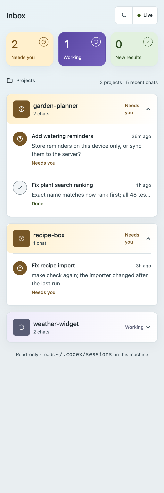
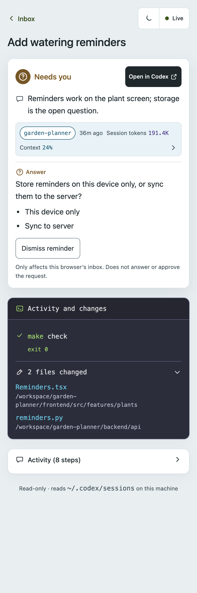
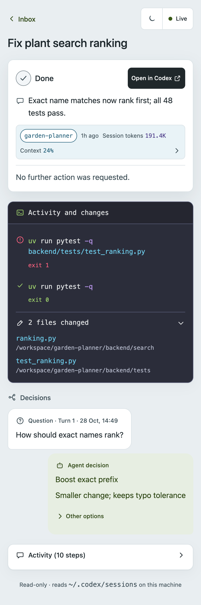

<div align="center">

# Codex companion

**See which Codex chats need you, what each one produced, and what to do next.**


[Start the companion](#start-the-companion) · [Commands](#commands-you-will-use) ·
[How it works](#how-it-works) · [Guides](#guides)





<sub>Screenshots use made-up demo chats from <code>make screenshots</code>, not real session data.</sub>

</div>

A local dashboard and Codex plugin. It reads the session files Codex already writes and turns each
chat into a short recap: status, outcome, next step, changed files, and checks.

## Why this exists

I run many Codex chats in parallel. Agent answers are long, so when I come back to a chat I lose the
outcome, the decision it is waiting for, or whether the tests ran after the last edit. Scrolling the
transcript to find that is slow, and with several chats open it is easy to miss the one that is
blocked on me.

The companion answers three questions per chat: does it need me, what happened, and what do I do
next. It does not control Codex. It only reads, and every action happens back in the Codex app.

The path from a busy afternoon of chats to the next action is:

**inbox → chat recap → Open in Codex → act**

## What you need

- Codex (desktop app or CLI), which writes chats to `~/.codex/sessions`
- Python 3.11+ and [`uv`](https://docs.astral.sh/uv/)

## Start the companion

```sh
git clone https://github.com/martin-gomola/ai-companion-app.git ~/dev/ai-companion-dash
cd ~/dev/ai-companion-dash
make up
```

Open [http://127.0.0.1:8787](http://127.0.0.1:8787) for the inbox, or `/?thread=<thread_id>` for one
chat. It works in a normal browser and in the Codex in-app browser.

To get structured recaps, install the plugin and restart Codex:

```sh
make mcp
```

`make mcp` registers this repo as a local plugin marketplace (`.agents/plugins/marketplace.json`
points to `plugin/`) and installs `codex-companion`. The plugin's MCP server runs from this checkout
through `uv`. If the repo lives somewhere other than `~/dev/ai-companion-dash`, set
`CODEX_COMPANION_REPO`.

## Commands you will use

| Command | Use it when |
| --- | --- |
| `make up` | Start the server in the background (`PORT=...` to change from 8787) |
| `make status` | Check whether it is running |
| `make logs` | Follow the server log |
| `make restart` | Pick up server code changes |
| `make down` | Stop the server |
| `make mcp` | Install or update the Codex plugin |
| `make test` | Run the test suite |
| `make screenshots` | Regenerate the README screenshots from demo chats (needs Google Chrome) |

## How it works

Codex writes every chat to `~/.codex/sessions/YYYY/MM/DD/rollout-<timestamp>-<thread_id>.jsonl`.
The companion tails those files; it never writes to `~/.codex`.

- **Inbox.** Chats are grouped by project in collapsible sections, with an overview of chats that
  need you, chats still working, and unseen results from the last 24 hours. It covers the 30 most
  recently updated chats and hides sub-agent chats. Project previews keep active chats and recorded
  next actions visible; older history sits behind a disclosure. Filtered chat links keep their
  return scope.
- **Project labels.** The session's working directory is matched to project roots in Codex's local
  state database. When that is unavailable, the label is the working-directory name.
- **Chat page.** The latest turn's outcome and next step, the files it changed, the checks it ran
  (tests, lint, type checks, builds), a warning when files changed after the last check, decisions,
  earlier turns, and the full activity timeline. **Open in Codex** opens the chat in the Codex app
  through its `codex://threads/<id>` link.
- **Handoff format.** The outcome and next step come from the agent's final answer. The plugin's
  `companion-handoff` skill asks agents to start every final answer with `**Outcome:**` and
  `**Next step:**`. Without those lines, the companion falls back to the answer's first sentence.
- **Decisions.** The questions Codex asked you, with your answers, plus choices the agent logs with
  the plugin's `log_decision` MCP tool.
- **Reminders.** **Dismiss reminder** removes a chat's request from the Needs you count in this
  browser, and **Restore reminder** brings it back. A new recorded request resurfaces on its own.
  Dismissals sync between tabs on the same origin and never answer a question or approve work in
  Codex. If browser storage fails, the reminder stays active; clearing site data clears dismissals.
- **Session info.** The expandable info bar shows the latest reported token totals and last-request
  usage from `token_count` records, and model and effort from `turn_context`. Session metadata
  supplies the provider, recorded Git branch, client version, and working directory. Cached input
  and reasoning are subsets of input and output, not extra totals. Missing counts stay unknown.
  Rate-limit snapshots in the logs are not used as a live account-quota meter.

## Privacy and limits

The server binds to `127.0.0.1` only and rejects other `Host` headers. It reads session files on
this machine and keeps seen and dismissed state in browser storage. Nothing leaves the machine.

Recaps are only as good as the agent's final answer. Chats from before the plugin was installed, or
agents that skip the handoff format, show the fallback sentence and an unknown next step.

## API

| Route | Returns |
| --- | --- |
| `GET /api/inbox` | Recent chats with status, outcome, and next step |
| `GET /api/threads/<id>` | Snapshot of one chat |
| `GET /api/stream?thread=<id>` | Server-sent `thread` events when that chat changes; without `thread`, `inbox` events |

## Project folders

```text
src/codex_companion/          FastAPI server, rollout parser, and MCP server
src/codex_companion/static/   Dashboard HTML, CSS tokens, and JavaScript
plugin/                       Codex plugin: manifest, MCP config, companion-handoff skill
tests/                        Parser and API tests
scripts/                      Demo-data screenshot generator for this README
docs/images/                  README screenshots
```

## Guides

- [Design contract](./DESIGN.md)
- [Handoff format skill](./plugin/skills/companion-handoff/SKILL.md)
- [Story specification](./story_specification.md)

## License

[MIT](./LICENSE)
